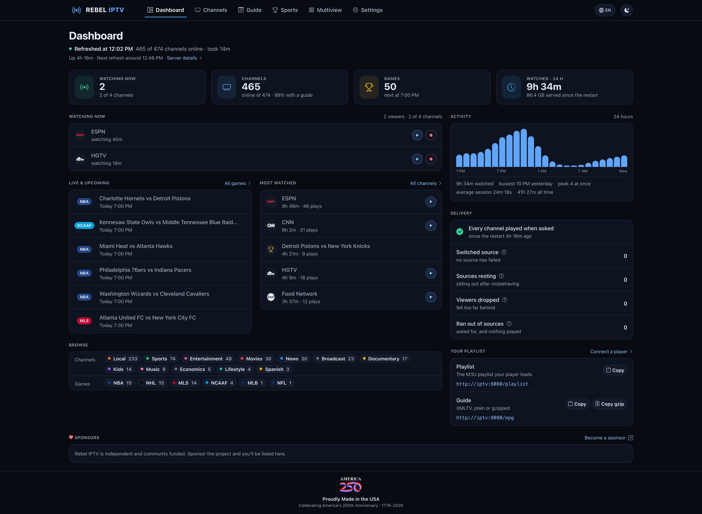
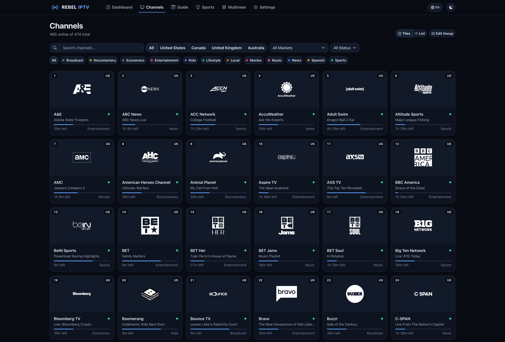
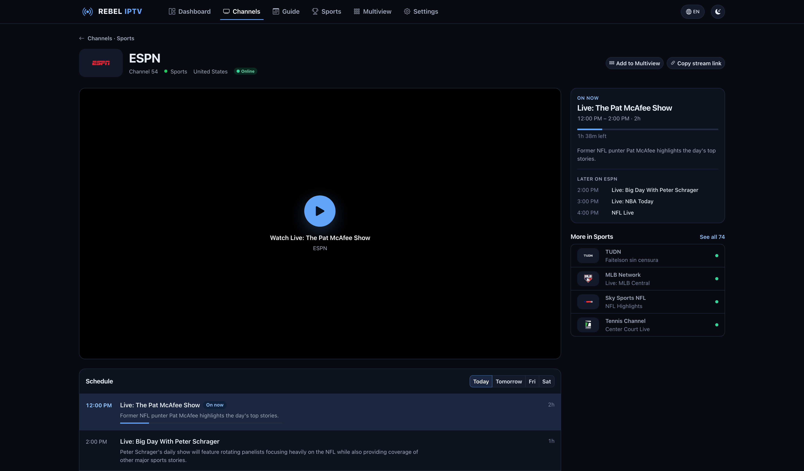
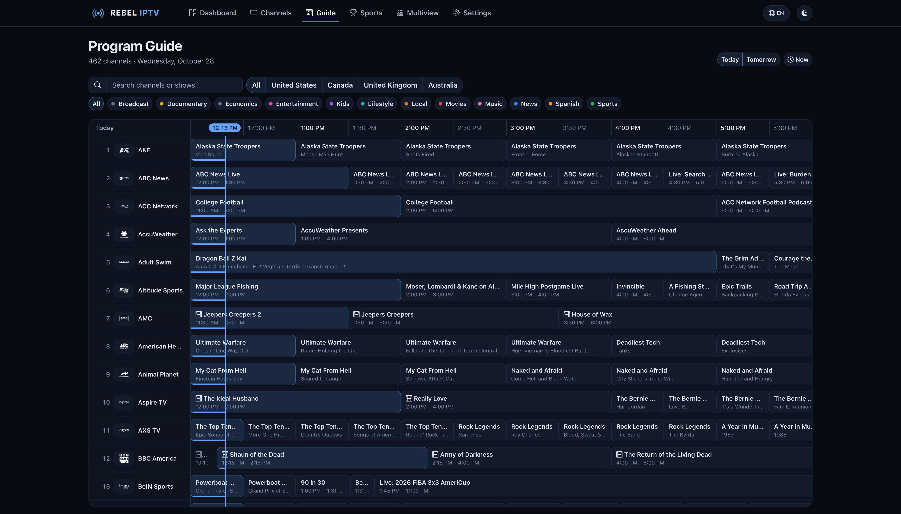
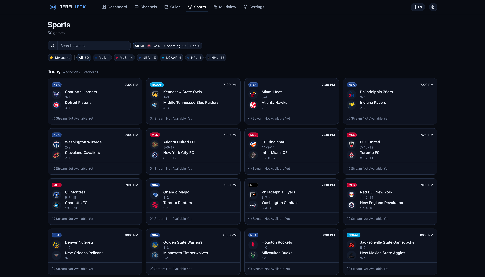
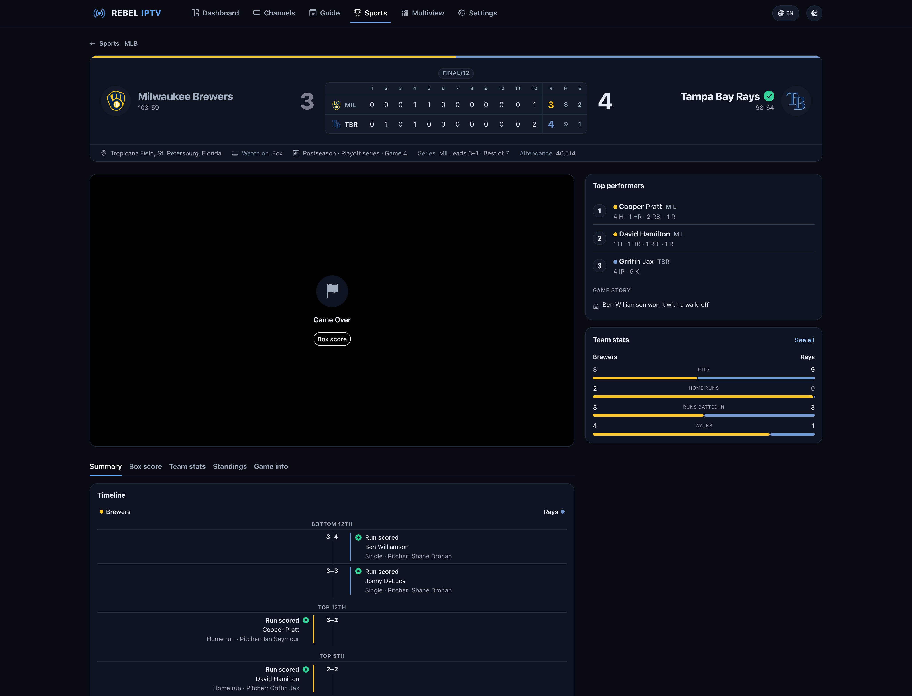
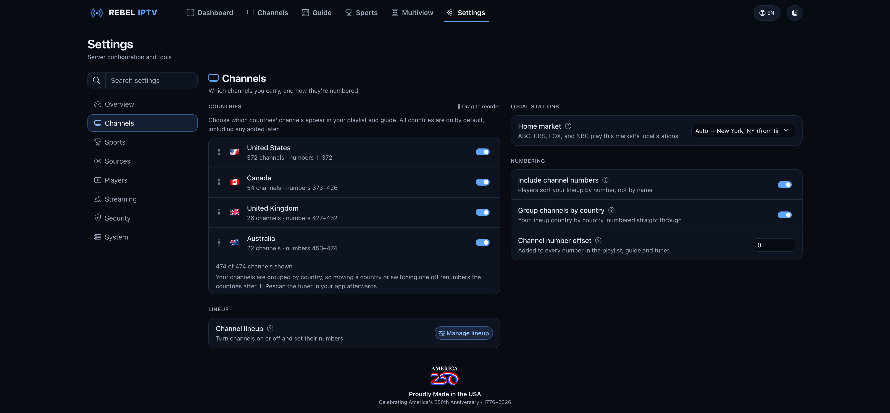

<div align="center">

# IPTV

**Self-hosted IPTV server for live TV and sports**

[](https://hub.docker.com/r/rebeliptv/iptv)
[](https://hub.docker.com/r/rebeliptv/iptv)
[](https://github.com/rebeliptv/iptv/releases/latest)
[](LICENSE)
[](https://www.rebeliptv.com)
[](https://github.com/sponsors/rebeliptv)

Aggregates live TV channels and sports events into a single M3U playlist with full EPG guide data.<br>
Streams are fully proxied so upstream sources are never exposed to clients.<br>
Designed for **Jellyfin**, **Emby**, **Plex**, and other apps that take an M3U playlist and an XMLTV guide.<br>
It can also answer as an **HDHomeRun tuner** — Jellyfin, Plex and Emby can all add it that way, and for
Plex and Emby it is the path their Live TV is built around.<br>
The web dashboard is available in **19 languages**.

**🌐 New here? Follow the step-by-step [setup guide at rebeliptv.com](https://www.rebeliptv.com).**

</div>

---

## Screenshots

<details>
<summary><strong>Dashboard</strong> — how your server is doing, what's playing, the games live and coming up, your most watched and the day's watch time</summary>
<br>


</details>

<details>
<summary><strong>Channels</strong> — every channel as a tile with the show on now and the time left, by country, market, status and category</summary>
<br>


</details>

<details>
<summary><strong>Channel Detail</strong> — the player first, what's on now and later beside it, more channels like it and the schedule day by day</summary>
<br>


</details>

<details>
<summary><strong>Guide</strong> — opens on what's on now, by country and category</summary>
<br>


</details>

<details>
<summary><strong>Sports</strong> — the day's games with each team's record, by status, league or your own teams</summary>
<br>


</details>

<details>
<summary><strong>Sport Event</strong> — the line score, the three stars, the game's story and timeline, team stats and the stream in one place</summary>
<br>


</details>

<details>
<summary><strong>Settings</strong> — eight sections and a search; here, your countries and their numbers, your home market and numbering</summary>
<br>


</details>

## Features

- **480+ TV channels** across the US, Canada, the UK and Australia, with logos, numbered 1, 2, 3 in your own lineup's order -- see [Channels](#channels)
- **Live sports events** -- games, fight cards and races together on the Sports page, in start order, and in your playlist and guide -- see [Supported Live Sports](#supported-live-sports) below
- **A channel for your favourite team** -- pick a team and it gets a permanent channel of its own that carries whichever game they're playing, home or away, and shows when they're next on the rest of the time -- see [Favourite Team Channels](#favourite-team-channels)
- **League channels, so Plex keeps your games** -- each league you follow can have its own set of channels, such as NHL 1 to NHL 16, that carry each day's games in kickoff order. The channels never change, so Plex pairs them once instead of losing track of your games from one day to the next -- see [League Channels](#league-channels)
- **Sports only** -- turn on **Sports only** under **Settings → Sports** and your server carries just the games: the dashboard counts games where it counted channels, and a refresh fetches the games alone, in seconds
- **The dashboard speaks your language** -- 19 of them: Arabic, Simplified and Traditional Chinese, Dutch, English, Finnish, French, German, Hindi, Indonesian, Italian, Japanese, Korean, Malay, Norwegian, Portuguese, Spanish, Swedish, and Urdu. Your browser's language is picked up the first time you open the dashboard, and the globe in the top bar changes it any time. The choice is stored on the server rather than in the browser, so it follows you to your phone and your TV box -- and dates, times, durations and temperatures follow it too, with Arabic and Urdu laying the whole dashboard out right-to-left
- **Custom M3U sources** -- add your own M3U URLs or upload files to merge into the playlist, each with its own guide if it needs one (a guide URL or an uploaded XMLTV file); edit the URL or replace the uploaded file later without losing channel numbers
- **Your lineup, your numbers** -- your apps get your channels numbered 1, 2, 3 in your lineup's order, counting only the ones that are on, so a channel you turn off leaves no gap. **Settings → Channels → Manage lineup** runs country by country: drag a channel, or click its number and type a new one, and filter by the channels that are on, turned off, offline or renumbered. Your choices persist across restarts and upgrades
- **Choose your countries** -- pick which countries' channels you carry from **Settings → Channels → Countries**, and drag them into the order you want; turn a country off and its channels leave the playlist, guide, dashboard, and search everywhere. Turn on **Group channels by country** under **Settings → Channels → Numbering** and your apps get your channels country by country, in that order, with your playlist grouping them under their country
- **Channel numbers that start where you want** -- a **Channel number offset** under **Settings → Channels → Numbering** adds the same amount to every channel number in your playlist, guide and HDHomeRun tuner, so these channels stay clear of another tuner's in Plex or Jellyfin. With an offset of 100, channel 1 becomes 101
- **Channel categories** -- Sports, News, Local, Kids, Movies, Entertainment, Lifestyle, Documentary, and more
- **Local station detection** -- identifies call signs (KABC, WCBS, etc.)
- **Multi-source stream fallback** -- events and channels start on the highest-priority source a check has confirmed working, and automatically try alternate providers if it fails, both at refresh time and mid-watch
- **Your home market's networks** -- ABC, CBS, NBC and FOX carry your own market's local station, for both the live feed and the guide, and lead your lineup from channel 1. By default the market comes from your server's timezone (Eastern → New York, Central → Chicago, Mountain → Denver, Pacific → Los Angeles, Alaska → Anchorage, Hawaii → Honolulu, and an Australian time zone → an Australian city); set your exact market under **Settings → Channels → Local stations → Home market**, from 44 US cities, 17 Canadian and 5 Australian. A home market outside the US leads with its own country's main networks, playing that city's stations, and the other countries' main networks leave your lineup while the rest of their channels stay. They only ever play your market's station: if it has no working feed, the channel says so and comes back with it, rather than switching you to another city's station. Choose **None** to number your own local stations instead. CW / PBS / ION have no local option and stay on their national feed.
- **Stream health monitoring** -- a channel shows online only while a check has confirmed one of its sources works; offline channels — and ones that answer but carry no audio or video — are detected automatically and recovered from a working feed
- **Live scores and stats** -- scores, the score by period, venue, weather and the game situation, refreshed every 5 seconds while a game is on and arriving already collected, so your server never has to reach the schedule sites itself
- **A page for every game** -- a scoreboard in the two teams' colours with the score by period, the venue, the weather and where to watch; beside the player, what's happening right now, the game's stars and the key team stats; and under it, the summary, the box score, team stats, standings and game info in tabs. Before a game it shows the preview: the probable starters, recent form, this season's earlier meetings and injuries, where the league has them. The three stars and the story of the game (a comeback, lead changes, a hat-trick, a shutout, an overtime winner, a walk-off) are worked out for you -- see [Sport Event Detail](#sport-event-detail)
- **Fight cards and race weekends** -- a fight card's page opens on the fight that's on, with the night's running order beside the player and every fight's tale of the tape, and **Hide results** keeps the winners out of sight until you ask; an F1 weekend's page shows where the weekend is, the timing beside the player, and the sessions, both championships, the season and the circuit in tabs
- **Scores that don't spoil the game** -- sports pages hold scores, plays and stats back to match your video, so a goal doesn't appear before you see it. **Match my video** is on by default and works out the delay from your server's own buffering; choose **Live scores** or a fixed delay in **Settings → Sports**. The choice is kept per browser
- **Rich EPG data** -- XMLTV guide with show descriptions, episode info, season/episode numbers, TV ratings, and poster artwork for shows, movies and games, read from two sets of listings: when one stops updating, each channel's schedule carries on from the other instead of going blank
- **A guide that opens on now** -- a timeline grid with a sticky channel column and a current-time line, opening on what's on now and next, with buttons for today, tomorrow and the days after, chips to show one category and, when your lineup has more than one country, buttons for one country's channels. Click a show that's coming up to see its description, its times and what follows it on that channel, or a show that's on now to open its channel
- **Light and dark** -- the colours of rebeliptv.com in dark and light, or auto to follow your system
- **Easy on a phone** -- on a phone, the dashboard's pages sit in a tab bar along the bottom of the screen, as in a phone app, with **More** for the rest
- **Multiview** -- watch up to four channels or games at once in a grid, any mix of the two, with sound from whichever picture you click. Pick what goes on each screen from a searchable browser of channels and the games that are on, and double-click a picture to make it large with the others beside it. Each picture uses one of your simultaneous streams, so the page shows how many are left for your other devices and stops you going past the limit; leaving the page frees them again. The **Recent** tab lists what you've put on a screen in the past week
- **Built-in video player** -- its own controls, the same in every browser: what's on across the top, and along the bottom a timeline over the programme where you can skip back and forth through what the player has buffered (a paused channel keeps buffering for up to 10 minutes), a **LIVE** button that shows how far behind live you are, volume, closed captions, picture-in-picture and fullscreen, with keyboard shortcuts; the channel and game pages add the up-next preview and live scoreboards
- **Closed captions** -- channels that carry captions can show them in the dashboard player: CC1, plus the digital caption services where a channel has them. They start off on every channel; turn them on from the **CC** button
- **Docker-network friendly URLs** -- a toggle in **Settings → Players** switches copied playlist / EPG URLs between the dashboard's origin and the container's internal hostname, so Jellyfin / Plex containers on the same Docker network work without hand-editing
- **Targeted refresh controls** -- refresh just channels, just events, just the guide, or everything, and follow it as it runs: the dashboard names each step, counts its progress, and says how it went and when the next refresh is due
- **Automatic failover** -- a brief provider hiccup is smoothed from the on-server buffer, a source that goes bad is swapped for a working one without stopping the stream, and if every source drops out the channel shows a *Reconnecting* card and comes back by itself as soon as one plays again. Jellyfin and Plex keep the sound when a channel moves to a source that sends its audio in another format
- **Says what's happening on screen** -- a channel that takes a moment to start shows a *Connecting to your channel* card instead of a blank screen, and a channel that is switching sources, one past your stream limit, or a game that hasn't started yet says so too, for as long as the wait lasts, then switches to the channel by itself -- in every app, not just the dashboard, so Jellyfin and Plex stay on the channel instead of dropping back to the guide
- **Stream stats** -- an optional panel under the player shows how much of your stream is buffered, how fast its source is delivering and how many are watching (**Settings → Streaming**)
- **Adjustable stream buffering** -- a channel starts in your apps once your server holds 15 seconds of it in memory, so a provider hiccup shorter than that is played out of the buffer and never reaches the screen; if a feed stops for longer, your apps show a *Reconnecting* card until the buffer is full again. Add more on top in **Settings → Streaming** if your feeds need it -- see [Stream Buffering](#stream-buffering)
- **Cache survives restarts** -- the playlist, guide, and in-flight stream tokens are restored on boot, so clients keep playing through a container restart
- **One-click in-app updates** -- upgrade to the latest version straight from the dashboard with an **Update now** button, no command line needed (see [Updating](#updating))
- **Restart from the dashboard** -- a **Restart** button in **Settings → System** stops and starts the server without a terminal on the host, on any setup; it comes back on the same version with nothing deleted (see [Restarting the server](#restarting-the-server))
- **Answers as an HDHomeRun tuner** -- Plex and Emby build their Live TV around HDHomeRun hardware, so
  the server can present itself as one and be added directly, no Plex Pass and no M3U-tuner flow
  (**Settings → Players**; see [Plex & Emby](#plex--emby))
- Continuous MPEG-TS stream proxy (works like a real TV tuner for Jellyfin/ffmpeg)
- Sport events sorted by start time with team logos and pregame/postgame EPG entries
- API key protection for playlist and EPG endpoints
- **Optional dashboard login** -- protect the dashboard with a username/password and add more admin accounts under **Settings → Security**; leave it unset to keep the dashboard open on a trusted network
- **Guided first-run setup** -- five short steps: where your channels come from, then your local stations, countries and live sports on one page (or the recommended settings), an optional dashboard sign-in and playlist key, and your app -- Jellyfin, Plex, Emby, Channels DVR or another -- with numbered steps and a Copy button beside every address
- Automatic hourly refresh in your time zone, with offline channel recovery every 5 minutes
- Graceful shutdown with SIGTERM handling
- **A small image** -- it carries only the server, with no operating system inside to keep patched; a container console, such as the Console button in Unraid or Portainer, has no shell to open
- Multi-architecture Docker support (amd64, arm64)

## Supported Live Sports

The following leagues currently have working live event feeds:

| League    | Sport                       |
|-----------|-----------------------------|
| **NHL**   | Ice Hockey                  |
| **NFL**   | American Football           |
| **NBA**   | Basketball                  |
| **MLB**   | Baseball                    |
| **MLS**   | Soccer (US)                 |
| **CFL**   | Canadian Football           |
| **NCAAF** | College Football            |

Schedules, team names and live scores arrive already collected, so your server never has to reach the schedule sites itself; your server's own job is finding the streams and matching each one to its game. If the listings can't be refreshed, the Sports page says they may be out of date rather than looking like a quiet day.

Fight cards and races share the Sports page with the games, in start order, whenever any are on the schedule. Other leagues will be added over time. To request one, [open a feature request](https://github.com/rebeliptv/iptv/issues/new/choose).

## Quick Start

> **Prefer a guided walkthrough?** The [setup guide at rebeliptv.com](https://www.rebeliptv.com) builds a Docker configuration tailored to your system (ports, timezone, in-app updates) and walks you through connecting Jellyfin / Plex. The manual setup below is the reference.

### Docker Compose (recommended)

Create a `docker-compose.yml`:

```yaml
services:
    iptv:
        image: rebeliptv/iptv:latest
        container_name: iptv
        hostname: iptv          # lets clients on this compose network reach us by name
        ports:
            - "8080:8080"
        # All environment variables are OPTIONAL — the defaults work out of
        # the box. Uncomment any you need (see Configuration below):
        # environment:
        #     TZ: "America/New_York"   # set to YOUR timezone, e.g. Europe/London, America/Chicago, Etc/UTC
        #     HEADLESS: "true"         # no browser on this box — see Headless Mode below
        volumes:
            - iptv-data:/app/data
            - /var/run/docker.sock:/var/run/docker.sock   # enables in-app updates (see Updating)
        stop_grace_period: 30s
        restart: unless-stopped

volumes:
    iptv-data:
```

```bash
docker compose up -d
```

> **Heads-up:** the `/var/run/docker.sock` mount lets the container update itself from the dashboard. It also gives the container control of the Docker daemon on the host — if you'd rather not allow that, remove the line and update with the standard `docker pull` method below instead.

### Docker Run

```bash
docker run -d \
  --name iptv \
  -p 8080:8080 \
  -v iptv-data:/app/data \
  -v /var/run/docker.sock:/var/run/docker.sock \
  --restart unless-stopped \
  rebeliptv/iptv:latest

# Environment variables are optional (defaults work). Add -e flags as needed, e.g.:
#   -e TZ=America/New_York   (set to YOUR timezone — e.g. Europe/London, Etc/UTC)
```

## Updating

### In-app update

When a newer version is available, an **Update now** button appears on the **Dashboard** and in **Settings → System** — click it and the server downloads the new version and restarts itself, with your data kept and no command line needed. This works out of the box with the Compose and `docker run` setups above, which mount the Docker socket so the container can update itself.

The button shows only on the `:latest` image when a newer release exists; it's hidden on version-pinned images (e.g. `:1.3.0`), which keep updating with the standard `docker pull` method below.

If a server ever gets too far out of date to run at all, it stops serving channels — but it still answers its usual address with a page telling you so, carrying the same **Update now** button and the commands to run if one-click updates aren't available on your setup. Left alone for half an hour it will go ahead and update itself, since a server in that state isn't serving anything anyway.

### Standard update

```bash
docker pull rebeliptv/iptv:latest
docker compose up -d
```

Your data lives in the `iptv-data` volume, so this just swaps in the new image — nothing is lost.

> **`docker restart` is not an update.** It starts the *same container* again on the *same old image*, so the new version you just pulled is never used and the server comes back reporting that it's still out of date. `docker compose up -d` is what replaces the container — it notices the newer image and recreates it for you.

### Headless Mode

If nothing on the box has a browser — a Kodi/LibreELEC box, a NAS, a headless server you only reach over SSH — set `HEADLESS=true`:

```yaml
environment:
    HEADLESS: "true"
```

The update prompt is part of the dashboard, so an instance nobody opens never gets told a new version exists, and older versions eventually stop working as sources change. In headless mode the server checks for itself and installs new versions on its own, waiting for a moment when nothing is streaming so it never interrupts a viewer. It also skips the first-run setup screen and starts building your playlist straight away, so a fresh install needs no visit to the dashboard at all.

This needs the `/var/run/docker.sock` mount from the setup above (the same one the **Update now** button uses) and the `:latest` image tag. Without them the server logs how to update by hand instead. Everything else — the dashboard, settings, the API — works exactly as it always did; the flag only changes what happens when nobody is watching.

## Restarting the server

**Settings → System → Restart the server** stops and starts the server for you, so a restart no longer means opening a terminal on the machine running it.

It comes back on the **same version** — this is not an update. Nothing is deleted and no setting changes: channels, guide data, metrics and your settings are all kept, because the server writes everything out before it stops. Anyone watching is disconnected and the playlist and guide URLs stop answering until it is back, which is usually a second or two. The dashboard reconnects on its own.

Unlike the **Update now** button, this one does not depend on your setup. With the `/var/run/docker.sock` mount from the setup above it restarts the whole container. Without it, it restarts the server inside the container that is already running — the same reset for almost everything, and the button says which one you are getting. It does **not** need the `:latest` tag either way: a version-pinned server restarts fine, since restarting it changes nothing about what it runs.

## Setting Up an API Key

Playlist and EPG endpoints can optionally be protected with an API key.

1. Open the web dashboard at `http://<server-ip>:8080`
2. Go to **Settings → Security**
3. Click **Generate a key**
4. Use the key in your client URLs: `http://<server-ip>:8080/playlist?key=YOUR_KEY`

Without a key, playlist and EPG are accessible to anyone on your network.

## Usage with IPTV Clients

### Jellyfin

1. Go to **Dashboard > Live TV > Tuner Devices > Add**
2. Select **M3U Tuner**
3. Enter the M3U URL: `http://<server-ip>:8080/playlist?key=YOUR_KEY`
4. The EPG guide URL is auto-discovered from the playlist header
5. Save and refresh guide data

**Recommended tuner settings:**
- Allow fMP4 transcoding container: **disabled**
- Allow stream sharing: **enabled**
- Auto-loop live streams: **disabled** — leave this **off**. With it on, Jellyfin transcodes every channel instead of playing it directly, and the transcode falls behind and freezes the picture. Streams are now standard-tuner compatible and no longer drop mid-watch, so auto-loop isn't needed. The only trade-off with it off: after a server restart or in-app update, re-select the channel to resume.
- Ignore DTS (decoding timestamp): **enabled** — makes the tuner tolerant of minor timing hiccups in a live feed instead of erroring on them. Not required (streams are already clean), but a harmless safety margin against a flaky source.
- Read input at native frame rate: **enabled**

**Or add it as an HDHomeRun tuner.** Jellyfin takes both types — pick **HDHomeRun** instead of
**M3U Tuner** at step 2 and enter `<server-ip>:8080`. The stream you get is identical either way.
The M3U route is listed first here for one reason: your playlist URL is protected by your API key
and the tuner's endpoints cannot be, so on a network you do not fully trust, M3U is the safer of the
two. See [Plex & Emby](#plex--emby) for the details that apply to any HDHomeRun client, and apply
whichever of the tuner settings above Jellyfin offers for that tuner type.

### Plex & Emby

Plex and Emby both build their Live TV around **HDHomeRun** network tuners, so this server can
answer as one. That is the supported path for both — no Plex Pass, and no M3U-tuner flow that moves
between releases. (Jellyfin can use the same tuner; see [Jellyfin](#jellyfin) for why the M3U route
is suggested there instead.) The rest of this section applies to any HDHomeRun client.

Turn on **Act as an HDHomeRun tuner** in **Settings → Players** (it is on by default), then add the
server by address.

> [!IMPORTANT]
> The tuner's endpoints are **not protected by your API key**. The HDHomeRun protocol has no field
> to carry one, so anything that can reach this server can read your channel lineup. Turn it on for a
> trusted or local network — not one exposed to the internet. Your playlist and guide URLs are still
> key-protected as normal.

**Plex**

1. **Settings → Live TV & DVR → Set up Plex DVR**
2. This server does not announce itself on your network — that is deliberate, so it never advertises
   your lineup to everything on the LAN. Click **Don't see your HDHomeRun?** and enter
   `<server-ip>:8080`
3. Skip the postal-code / antenna lineup step
4. Choose **Have an XMLTV guide?** and give it `http://<server-ip>:8080/epg?key=YOUR_KEY`
5. Check the channel mapping Plex proposes — channels match by number and name — then save

**Emby**

Same shape: **Live TV → Add tuner → HDHomeRun**, enter `<server-ip>:8080`, then add the same EPG URL
as an XMLTV guide source.

**How many channels at once**

Both clients ask the tuner how many streams it can serve. That number is **Settings → Streaming →
Simultaneous streams**, and it is a real limit on every way of connecting — see
[Simultaneous Streams](#simultaneous-streams).

<details>
<summary>Plex via M3U instead (not recommended)</summary>

Plex does have an M3U path, but it **requires an active Plex Pass**, is not officially supported, and
the steps have changed between Plex releases. Prefer the tuner above. If you still want it, follow
Plex's own current M3U / XMLTV instructions — they are the authority on their own flow — and give it:

| Plex asks for | Give it |
|---|---|
| Tuner / M3U | `http://<server-ip>:8080/playlist?key=YOUR_KEY` |
| XMLTV guide  | `http://<server-ip>:8080/epg?key=YOUR_KEY` |

</details>

### General IPTV Clients

| File             | URL                                             |
|------------------|-------------------------------------------------|
| M3U Playlist     | `http://<server-ip>:8080/playlist?key=YOUR_KEY` |
| EPG Guide (XML)  | `http://<server-ip>:8080/epg?key=YOUR_KEY`      |
| EPG Guide (Gzip) | `http://<server-ip>:8080/epg.gz?key=YOUR_KEY`   |

> **Note:** The `?key=` parameter is only required if an API key has been generated in the web dashboard under **Settings → Security**.

## Simultaneous Streams

**Settings → Streaming → Simultaneous streams** sets how many channels this server will play at once.

It applies to **every** way of connecting — the HDHomeRun tuner, an M3U playlist, and this dashboard.
Watching the same channel on several devices counts as **one**, because they share a single feed out
to the source; it is a limit on distinct channels, not on people. A channel counts once it starts
playing: one that is still starting, or trying sources that don't work, doesn't use up a stream.

It counts the built-in channels only. **Your own custom sources are not included** — those are fetched inside your own network rather than from the channel sources this limit exists to stay within, so run as many of them as your connection can carry.

| | |
|---|---|
| Default | **4** |
| Range | 1 – 32 |

Ask for a channel beyond the limit and it shows a **stream limit reached** card rather than failing,
then starts on its own, in the same stream, as soon as another channel stops — in every app, with no
need to go back and pick it again.

Set it to match what the line behind your channels can actually carry. Too high and the source
refuses first, which reaches you as its error rather than ours, with nothing to explain it. Too low
and you meet the card sooner than you need to.

> [!NOTE]
> Before **v1.4.0** the number was only advertised to Plex, Emby and Channels DVR — nothing
> enforced it. It is a real limit from v1.4.0 on, so a setup regularly playing more than **4**
> channels at once needs the number raised.

## Web Dashboard

Access the dashboard at `http://<server-ip>:8080`.

On first launch a setup wizard gets you watching in five short steps: choose where your channels come from; pick your local stations, countries and live sports on one page, or take the recommended settings and skip the choices; add a dashboard sign-in and a playlist key, now or later; then pick your app (Jellyfin, Plex, Emby, Channels DVR or another) and follow its numbered steps, with a **Copy** button beside every address you paste in. If you added a key, the addresses already include it. You can change anything later in Settings.

### Pages

- **Dashboard** -- a line under the title says how your server is doing, then anything that needs you, then four numbers that open their pages: who's watching, your channels (and how many have a guide), the games and what's been watched in the last 24 hours. On the left are what's being watched right now, each with a play button and a stop button that ends the stream for everyone watching it, the live and upcoming games, your most-watched channels, and every category and league to browse. On the right are the day's watch time hour by hour, a **Delivery** panel showing how reliably your box has been serving (sources switched and why, viewers dropped, and whether a channel ran out of working sources while someone was watching; the **?** beside each explains it), and your playlist and guide addresses to copy. While your server refreshes, it names each step in plain words with a count where there is one, and afterwards says when the refresh finished, how many channels are online and when the next one is due. Nothing jumps when someone starts or stops watching, and on a phone it's one column. With **Sports only** on, it counts games where it counts channels
- **Channels** -- every channel as a tile with its logo and the show on now, with a progress bar and the time left, or what's on next; or switch to a list. Search matches the channel name, network and city, and you can filter by country, market, status or category; the rows always fill the width of your screen. **Play** opens the channel's page and starts it there
- **Guide** -- a timeline grid with a sticky channel column and a current-time line, opening on what's on now and next, with buttons for today, tomorrow and the days after and chips to show one category; when your lineup has more than one country, buttons show one country's channels. Click a show that's coming up to see its description, its times and what follows it on that channel; click a show that's on now, or a channel's name, to open the channel. Each show's episode title is shown, and on a phone a show's details slide up from the bottom
- **Sports** -- the games that are on first, then today's, tomorrow's and the days after, with fight cards and races among them in start order. Each card shows both teams with their records, the score and the clock while a game is on, and a **Watch** button once it can be played. Filter by status or league, or pick **My teams** for your favourite teams' games. Click a game for its page with the scoreboard and video player. If the listings can't be refreshed, a banner says they may be out of date — and whether the schedule service is behind (it recovers on its own) or your server can't reach it — rather than leaving the page looking like a quiet day
- **Multiview** -- up to four pictures on one screen. Choosing what goes on a screen opens a browser of your channels and the games that are on: search by name, number, show or team, filter by category and country, and see what each channel is airing and how long is left; feeds already on another screen are marked, and a screen's channel can be changed without clearing it first. Click a picture to move the sound to it (mute it from its speaker button); the one you're listening to is outlined. Double-click a picture to make it large, with the others beside it (under it on a phone); click a small one to swap it in, and double-click the large one, or press Esc, to go back to the grid. Each X clears its own box, and the header tells you how many of your simultaneous streams are in use. The **Recent** tab keeps what you've put on a screen in the past week, and **Add to Multiview** on a channel's page opens the channel here. On a phone the boxes stack
- **Settings** -- eight sections, each answering one question: **Overview** (how your server is doing, anything that needs you, a manual refresh of channels, the guide, events or all of them with each step as it runs, and your instance ID), **Channels** (your countries and their order, the lineup page, numbering — channel numbers in the playlist, grouping by country and the channel number offset — and your home market), **Sports** (carrying sports, sports-only mode, league channels and the order of your leagues, score timing and favourite-team channels), **Sources** (the feed source, local scraping or Rebel IPTV's hosted feeds, and your custom M3U sources, each with its guide URL or guide file), **Players** (your playlist and guide addresses, the Docker container-hostname toggle, setup steps for your app, and the HDHomeRun tuner), **Streaming** (extra buffering, the stream stats panel and how many streams play at once), **Security** (the API key, and the dashboard login with its admin accounts) and **System** (the version and one-click in-app upgrade, the dashboard language, restarting the server, purging and rescraping, and resetting stream statistics). A search box finds any setting, every change says when it's saved, and bigger changes ask first
- **Favourite Teams** (**Settings → Sports → Favourite teams**) -- your picks as a set of cards, each showing what its channel is doing right now; add a team by sport or by typing its name, and drag them into the order you want their channel numbers in

On a phone, the dashboard's pages sit in a tab bar along the bottom of the screen, with **More** for the rest.

### Channel Detail

Click any channel to see its page:
- The player first (click to watch), with a timeline you can skip through, a **LIVE** button and closed captions, and a stream stats panel under it when that is turned on
- The channel's schedule under the player, a day at a time, with what's on now and next beside it
- A few more channels like it, different each time you open it: for a local station, others from its own city
- **Add to Multiview**, and **Copy stream link** for the address your player app opens the channel at

### Sport Event Detail

Click any game to see its page:
- A scoreboard in the two teams' colours, with the score by period, the clock, the venue, the weather and where to watch, refreshed every 5 seconds while the game is on
- Embedded video player with automatic fallback to alternate stream sources
- Beside the player, what's happening right now, the game's stars and the key team stats, or the preview before it starts
- Under it, everything about the game in tabs: the summary, the box score, team stats, standings and game info

Every sport's page is built from the same parts, wherever the league has them. During and after a game: the scoring plays and key moments on a timeline, each team's on its own side; team and player stats; and the three stars and the story of the game (a comeback, lead changes, a hat-trick, a shutout, an overtime winner, a walk-off), worked out for you. Before a game: the probable starters, recent form, this season's earlier meetings, the injuries, and both teams' season so far side by side. Around it: the line-ups, standings, officials and weather. Game status and stat names appear in your dashboard's language.

Scores, plays and stats are held back to match your video, so a goal never shows up on the page before you see it. **Match my video** is the default and works out the delay from your server's own buffering; **Settings → Sports** offers **Live scores** or a fixed delay instead, kept per browser.

A football game adds every drive, and while it's on, the current one: the down and distance, which team has the ball and where, whether they are in the red zone, and each side's remaining timeouts.

A fight card's page opens on the fight that's on: both fighters with their flags, records and belts, and the round with the time left in it. Between fights it shows the next one up, and before the card the main event. Beside the player is the night's running order, from the early prelims to the main event, with who won, how and in which round. Pick any fight to see its tale of the tape (age, height, reach and stance), the fighters' career numbers going in, and the fight's own stats once it starts. **Hide results** keeps every winner, finish and stat out of sight until you ask for it, and your browser remembers the choice.

An F1 weekend's page opens on where the weekend is: the race under way with its lap and who leads, how it finished, or the next session and when it starts. Beside the player is the timing: during a race the running order with each car's pit stops, after it the classification with the points each driver scored, before it the starting grid. Under the player, tabs hold the weekend's sessions, both championships, the season with every winner, and the circuit.

### Watching on a TV

The dashboard's player has no Cast button, and that is a browser rule rather than a
missing feature: a page may only offer casting over HTTPS, and your dashboard is served
over plain `http://` at a local address. Two things work today without any of that:

- **Cast or mirror the page yourself.** In Chrome, **⋮ → Cast** sends the tab to a
  Chromecast or Google TV; on a Mac, AirPlay screen mirroring does the same. Your
  computer does the work, so it needs to stay awake.
- **Cast from your media server.** Jellyfin, Plex and Emby all cast properly from their
  own apps, and they are already being fed by this server — so for watching on a TV that
  is the better route anyway.

## Configuration

| Variable        | Default      | Description                                                                                                  |
|-----------------|--------------|--------------------------------------------------------------------------------------------------------------|
| `PORT`          | `8080`       | Server port                                                                                                  |
| `HOST`          | `0.0.0.0`    | Bind address                                                                                                 |
| `CRON_SCHEDULE` | `30 * * * *` | Data refresh schedule (cron), in your `TZ`. Each server starts its refresh at a set time of its own, up to 20 minutes after the schedule, so that servers don't all refresh at once |
| `TZ`            | `Etc/UTC`    | Timezone. Also picks your default home market, whose stations ABC / CBS / NBC / FOX play — override it in **Settings → Channels → Local stations → Home market** |
| `HEADLESS`      | `false`      | For boxes with no browser — see [Headless Mode](#headless-mode)                                              |
| `TRUSTED_PROXIES` | *(none)*   | Only if you run behind a reverse proxy — see [Reverse Proxy](#reverse-proxy)                                 |
| `RESET_AUTH`    | `false`      | Locked out of the dashboard? Set to `true` and restart: every dashboard login is removed and the dashboard opens so you can set a new one. Remove it again afterwards — while it is set, logins are cleared on every start |

> **Sports options** — whether to carry sports at all, sports-only mode, and which leagues to carry — are now dashboard settings under **Settings → Sports**, not environment variables. (An existing deployment's `SPORTS_EVENTS` / `SPORTS_MODE` / `LEAGUES` env values are still honoured once, as a one-time seed on upgrade; after that the dashboard owns them.)

> **Source mode (local scraping vs hosted feeds)** is a dashboard setting, not an environment variable — see [Hosted Feeds](#hosted-feeds).

### Cron Schedule Examples

| Schedule       | Meaning                                |
|----------------|----------------------------------------|
| `30 * * * *`   | Every hour at 30 minute mark (default) |
| `*/30 * * * *` | Every 30 minutes                       |
| `0 */3 * * *`  | Every 3 hours                          |
| `0 0 * * *`    | Once a day at midnight, in your `TZ`   |

### Blocked Sources

If some providers are blocked or geo-restricted in your region, switch to
[Hosted Feeds](#hosted-feeds) (**Settings → Sources → Feed source**). Your instance then
pulls ready-made channels, guide, and events from Rebel IPTV instead of
scraping the blocked providers itself, so regional blocks no longer matter.

### Hosted Feeds

By default your instance builds everything itself — it scrapes the sources,
assembles the playlist and guide, and proxies the streams. If you'd rather
your box not run the scrapers at all, switch it to hosted feeds from the
dashboard: **Settings → Sources → Feed source → Use Rebel IPTV playlist**.

Your instance then pulls its channels, live sports events, and guide from
Rebel IPTV's hosted service and serves them through your usual playlist,
guide, and stream endpoints — so the feeds are assembled and kept healthy
centrally instead of on your hardware. Nothing changes on the player side
(Jellyfin/Plex/Emby keep working exactly as before); only where the feeds
come from changes. In this mode there's no local scraping. Leave the
toggle off to keep your instance fully self-contained.

Your channel lineup is the same either way. Channels carry the same IDs in
both modes (they resolve against the same curated directory), so toggling
doesn't reshuffle your lineup or break your client's channel mappings and
bookmarks — only where the feeds come from changes. Switching takes effect
live: your instance rebuilds its channels, guide, and events from the
newly-selected source, and the toggle is disabled while that repopulates,
re-enabling once it finishes.

## How It Works

### Channels

On startup and once an hour, the server scrapes channel data, normalizes names, detects categories, and checks stream health. Offline channels are rechecked every 5 minutes.

Your channels are numbered **1, 2, 3** in your lineup's order, counting only the ones that are on: a channel you turn off has no number and the channels after it move up, while one that's only offline keeps its number. Your home market's networks always come first, from 1. Numbers are allocated in ranges:

| Range     | Use                                           |
|-----------|-----------------------------------------------|
| 1–3999    | Your channels, in your lineup's order         |
| 4000–4199 | Your favourite team channels                  |
| 5000+     | Live sports events, each day's in kickoff order, or [league channels](#league-channels) when they're on |
| 10000+    | Custom M3U sources (one range per source)     |

To move every number up, set a **Channel number offset** under **Settings → Channels → Numbering**: it adds the same amount to each number in your playlist, guide and HDHomeRun tuner, so an offset of 100 puts channel 1 at 101 and keeps these channels clear of another tuner's in Plex or Jellyfin. Changing it renumbers every channel, so rescan the tuner in your player afterwards.

**Settings → Channels → Manage lineup** runs country by country, in your country order, each country headed by the numbers its channels run through. Turn off the channels you don't watch (they drop out of your playlist, guide, and counts), drag a channel within its country, or click its number and type a new one; moving a channel renumbers only the channels it passes. Your home market's networks are pinned at the top, and each goes on and off with the local station it plays. These choices are saved with your data, so they persist across restarts, upgrades and a purge. Rescan the tuner in your app after changing them, so it picks up the new numbers.

Turn on **Group channels by country** under **Settings → Channels → Numbering** and your apps get your channels country by country, in the order of your countries under **Countries**: your home market's networks first, from 1, then each country's channels, numbered straight through.

Local broadcast stations are identified by their FCC call sign. For example, "ABC (KABC) Los Angeles" becomes **KABC Los Angeles CA (ABC)** — call sign, market, and network — and gets a logo showing the network mark with the call sign and city. Because the city and network are in the name, you can find a local station by searching for its city (e.g. **Los Angeles**) or network (e.g. **ABC**) in your player.

Channels are grouped by category in the M3U playlist using `group-title`. Multiple categories are supported (e.g., a local station gets both "Local" and "News"). With **Group channels by country** on, they're grouped by their country instead.

### Custom M3U Sources

Add your own M3U playlists from the Settings page: by URL, as an uploaded file, or as a file you keep in your data folder (see below). Custom channels are merged into your playlist and EPG, numbered in the 10000+ range, and persist across restarts.

Each source can be edited after adding — rename it, change the URL, or upload a replacement M3U file — without losing its channel-number slot. A source can't point back at this server: its own playlist, guide or streams are refused when you add them, since the server would otherwise fetch from itself in a loop. A source that already points back at it is removed when the server starts, with the copies of your channels it made, and an EPG URL that is the server's own guide is dropped. Turn on the optional **Validate** toggle and the server health-checks each stream and marks offline ones red. While a source is being fetched or validated in the background, the entry shows a "loading" pill and updates automatically when the check completes.

**Guide listings.** A guide is picked up automatically when your playlist links one. Plenty of playlists don't — an uploaded file, or a provider that publishes its guide at a separate address — so each source also takes an **EPG URL** of your own, when you add it and when you edit it. If the guide comes as a download rather than at an address, **Upload a file** instead — an XMLTV file, plain or gzipped. A source's guide is one choice: the playlist's own, a URL, an uploaded file, or a file from your data folder. An uploaded guide covers only the dates it was published for, so upload a fresh one when it runs out. Guide entries are matched to your channels by `tvg-id`, and by name when the id doesn't line up, so a hand-made M3U with no ids still gets its listings. The sources list shows how many guide entries each source holds, and when it holds none it says why — the playlist links no guide, the guide couldn't be downloaded, or the guide covers none of your channels.

**Files in your data folder.** Put a playlist in the `custom-m3u` folder or an XMLTV guide in the `custom-epg` folder of your data volume (`/app/data/custom-m3u` and `/app/data/custom-epg` inside the container), then choose **From your data folder** when you add or edit a source and pick the file. The file is read again on every refresh, so a guide another program keeps writing stays up to date in your guide too. If `/app/data` is a Docker volume rather than a folder on your server, as in the Quick Start, nothing outside the container can write into it: mount a folder from your server at `/app/data/custom-epg` or `/app/data/custom-m3u` instead. The dashboard shows how each folder is mapped and the line to add. Removing a source never deletes your file.

### Sports Events

Every event on the schedule — a game, a fight card or a race — comes with its start time, names and live score, and your server finds the streams for it and matches each one to its event. Events are sorted by start time across all leagues.

Each event gets EPG entries with pregame, game, and postgame blocks:

| Event        | Pregame | Game                          | Postgame |
|--------------|---------|-------------------------------|----------|
| NFL          | 30 min  | 4 hrs                         | 30 min   |
| College football | 30 min | 4 hrs                     | 30 min   |
| MLB          | 30 min  | 3.5 hrs                       | 30 min   |
| NHL          | 30 min  | 3 hrs                         | 30 min   |
| MLS, CFL     | 30 min  | 3 hrs                         | 30 min   |
| NBA          | 30 min  | 2.5 hrs                       | 30 min   |
| Fight card   | 30 min  | 6 hrs (from the first bout)   | 30 min   |
| Race         | 30 min  | 2.5–4 hrs                     | 30 min   |

An event that runs long — overtime, extra innings, a late main event — keeps its guide listing extending until it ends, so the guide never shows postgame over a game that is still on.

An event joins your playlist and guide as soon as a feed is found for it — usually well before kick-off — with the start time in the guide telling you when it begins. Waiting until the feed was confirmed live meant the game only appeared about a minute after it had already started, so a player that reads your lineup once each morning never saw that night's games at all. A finished game is not dropped at the final whistle either: it stays listed for as long as its feed keeps running, so the channel rides through post-game coverage instead of cutting off mid-broadcast.

Event channels are numbered from **5000**: each day's events in kickoff order, all of them, the first time the day is published, and each keeps its number all day, so a number never moves to another game when a feed turns up. An event added later takes the next free number. They're grouped in your playlist under their league — games, fight cards and races alike, so a card or a race sits right beside the games and is tagged as sports in your guide.

### League Channels

Plex remembers the channels it found when you set it up, and a channel per game changes every day, so Plex loses track of your games from one day to the next. Turn on **League channels** under **Settings → Sports** and each league you follow gets its own set of channels in place of a channel per game, such as NHL 1 to NHL 16. Each day's games go onto them at the start of the day, in kickoff order, with their listings and artwork, and keep their channel all day; a game plays once its stream is found. The channels themselves never change, so Plex pairs them once.

Each league holds a block of 100 numbers from **5000**, in the order of your leagues under **Settings → Sports**: drag them into the order you want, and the first league's channels get the lowest numbers. A league added later goes at the end, so it never moves yours, and the leagues list shows each league's channel numbers. A game that fits on none of its league's channels gets a channel of its own from **8000**. A league channel shows the game it's carrying as its logo, and its own logo with its league and number when it has none.

Rescan the tuner in your app after turning league channels on, and after moving a league. Jellyfin changes a channel's logo when it refreshes its guide, once a day unless you set **Refresh Guide** under Scheduled Tasks to run every hour.

### Favourite Team Channels

Pick a team under **Settings → Sports → Favourite teams** and it gets a channel of its own. Whenever that team plays — home or away — the channel carries the game, so you can tune straight to your team instead of hunting through the night's fixtures for them. The rest of the time it shows a card saying their next game is coming up (or that none is scheduled), and switches to the game by itself when it starts; the guide lists their upcoming games with their start times.

Team channels are numbered from **4000**, just below the individual events, and you choose the order by dragging them. That number is fixed and does not reshuffle, so it is safe to map in your player. A team channel carries the same feed as the event channel for that game, so watching one costs no extra load on your box.

Requires live sports to be on (**Settings → Sports → Show sports events**).

### Stream Buffering

A channel starts in your apps once your server holds all of its buffer in memory: 15 seconds, plus any **Extra buffer** you add. A stall shorter than that drains the buffer instead of interrupting playback, so it never reaches the screen. A stall longer than the buffer can't be hidden: Plex, Jellyfin and your other apps show a *Reconnecting* card when it runs out, and the card stays until the buffer is full again, so the hiccups after it are covered too. Channels and live games are buffered the same way.

If your feeds still freeze for a second or two when a provider hiccups, set **Extra buffer** under **Settings → Streaming** to the number of seconds to add on top of that cushion. The trade-off is delay: every stream plays that much further behind live, and a feed that only sends in real time takes as long as its whole buffer to start after you tune in — that wait *is* the buffer filling, and your player shows a *Connecting to your channel* card while it does. Buffering applies in both local and hosted-feed modes and to any player (Jellyfin, Plex, Emby, or the built-in web player); some players add a little of their own start-up time on top. Leave it at **0** for the closest thing to live.

## Persistent Data

Everything that needs to survive a restart lives in the `/app/data` volume, encrypted at rest:

- **`iptv.db.gcm`** — encrypted snapshot of all data: channels, sports events, EPG guide, custom-source definitions, your API key, and runtime metrics
- **`instance.key`** — your server's identity key, made on its first start; your server signs in with it, so keep it with the rest of the folder when you back up or move your server. Your instance ID stays the same
- **`custom-m3u/`** — custom-source playlists: the files you upload, and any you put here yourself to pick in the dashboard
- **`custom-epg/`** — custom-source guide files, uploaded or put here yourself; a file you put here is read again on every refresh

To put files in those two folders from outside the container while `/app/data` is a Docker volume, mount a folder from your server at `/app/data/custom-m3u` or `/app/data/custom-epg` (see [Custom M3U Sources](#custom-m3u-sources)).

The server cleans up after itself: files left in the folder by a stop partway through a guide download, an upload or a save are deleted the next time it starts, and a copy of saved data it couldn't read, kept in case you need it back, is deleted after 30 days.

The snapshot is AES-256-GCM encrypted, so the on-disk file is opaque — running `sqlite3 iptv.db.gcm` just reports "file is not a database". While the server is running it works against a plaintext copy held in memory that never touches persistent storage; on a clean shutdown that copy is re-encrypted back into the snapshot.

Your lineup's order and which channels are on are kept apart from the channels themselves, so a purge and rescrape gives you back the same numbers.

## Reverse Proxy

The server builds the URLs in your playlist and guide from the `Host` header your proxy passes through, and switches them to `https` when the proxy sends `X-Forwarded-Proto: https` — so make sure your proxy forwards the original `Host`, as both examples below do.

Set `TRUSTED_PROXIES` to your proxy's address so the server knows which `X-Forwarded-For` headers to believe when it records who is connecting — a comma-separated list of addresses or CIDR ranges:

```yaml
environment:
    - TRUSTED_PROXIES=172.16.0.0/12
```

Leave it unset and the server trusts no proxy at all, which is the safe default: without it, anyone could put whatever they liked in that header and, for instance, sidestep the dashboard's login rate limit by pretending to be a different visitor each try. Everything still works unset — only the client addresses in your logs and rate limiting are affected.

### Nginx

```nginx
location / {
    proxy_pass http://127.0.0.1:8080;
    proxy_set_header Host $host;
    proxy_set_header X-Forwarded-For $proxy_add_x_forwarded_for;
    proxy_set_header X-Forwarded-Proto $scheme;
}
```

### Traefik

```yaml
labels:
    - "traefik.enable=true"
    - "traefik.http.routers.iptv.rule=Host(`iptv.example.com`)"
    - "traefik.http.services.iptv.loadbalancer.server.port=8080"
```

## Sponsors

Rebel IPTV is **100% community funded**.

Sponsoring is entirely optional. There is no paid tier, nothing is locked behind it, and nothing
changes for you if you never do — the project stays exactly as it is either way. If you find it
useful and would like to help cover the work that goes into it, you can do that through
[GitHub Sponsors](https://github.com/sponsors/rebeliptv).

Anyone who sponsors is listed on the **Sponsors** panel at the foot of your own dashboard, as a
thank-you. Sponsors who choose to stay private on GitHub are never listed anywhere.

## Reporting Issues

Found a bug or want a feature? [Open an issue](https://github.com/rebeliptv/iptv/issues/new/choose) using one of the templates:

- **Bug Report** -- something isn't working
- **Feature Request** -- suggest an improvement
- **Channel Request** -- missing or broken channel

## License

Proprietary -- free for personal, non-commercial use. See [LICENSE](LICENSE) for details.

**Forking this repository is a violation of the license.** This software may only be used in its published binary/container form. Forking, copying, or otherwise reproducing this repository creates an unauthorized derivative work, and all forks are subject to takedown.
